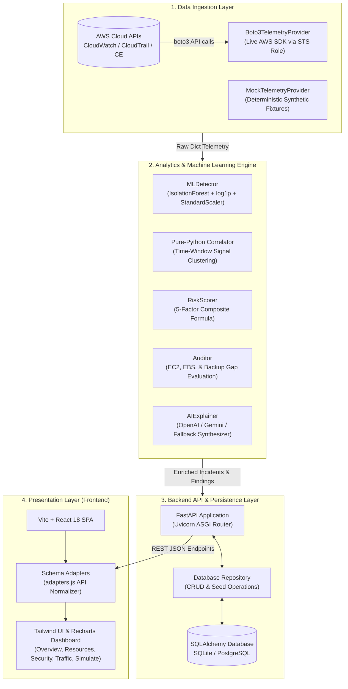
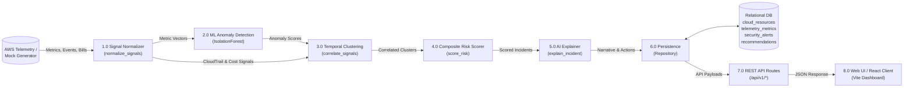
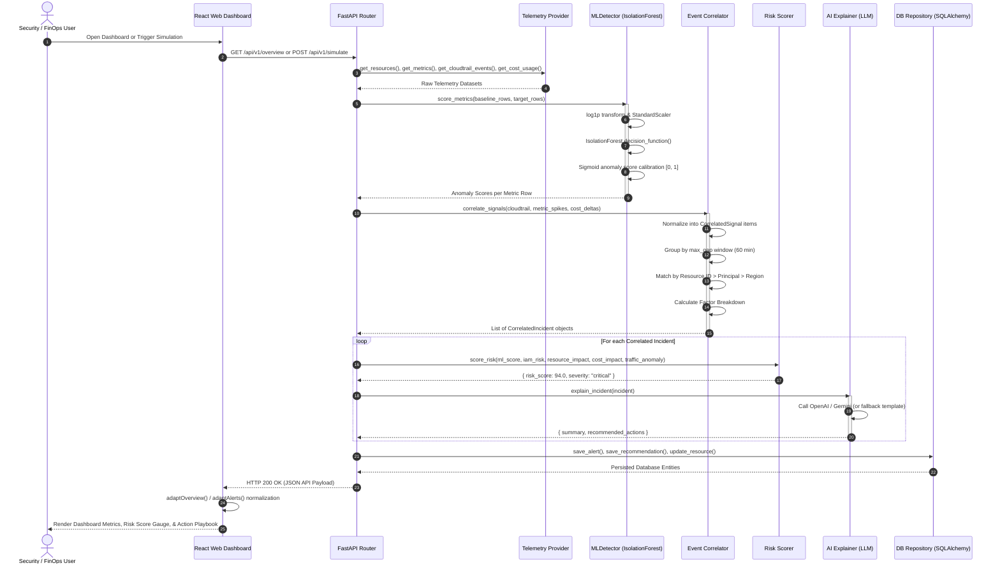
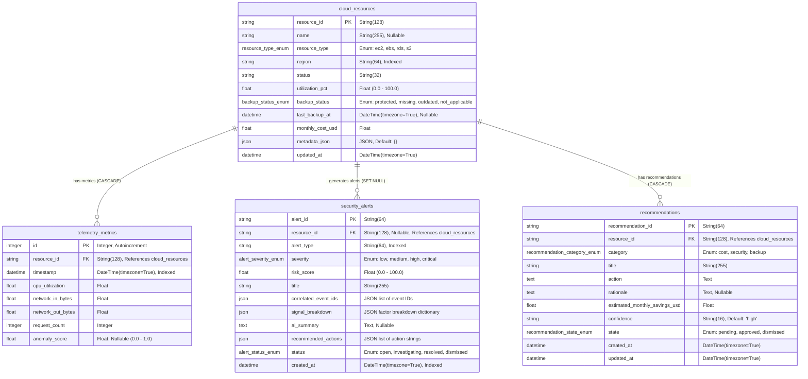

# AWSense — System Analysis, Design & Architecture Specification

## 1. Executive Summary & Problem Statement

Modern enterprise cloud infrastructure hosted on Amazon Web Services (AWS) generates high volumes of disparate, disconnected telemetry data:
- **CloudWatch Metrics & Logs:** High-frequency time-series data reflecting CPU utilization, network traffic, and I/O metrics.
- **AWS CloudTrail:** Immutable API audit trails tracking IAM principals, assumed roles, security group modifications, and resource lifecycle events.
- **AWS Cost Explorer & Billing:** Granular daily and monthly cost allocations, usage records, and service-level financial anomalies.
- **Application & VPC Traffic Logs:** Ingress/egress access logs, bot scrapers, and volumetric request patterns.

### The Siloed Telemetry Challenge
When monitored in isolation, these telemetry streams fail to surface complex, cross-domain incidents:
- A CloudWatch alert for high CPU may be dismissed as a batch job, missing that it originated from an unauthorized instance provisioned by a compromised credential.
- An unusual IAM login in an unused region may appear harmless unless linked to immediate security group openings and subsequent compute spin-ups.
- A sudden increase in billing may only be detected weeks later on the monthly invoice, long after an automated bot scraping attack has inflated auto-scaling groups and egress costs.

### AWSense Mission
**AWSense** bridges the gap between Cloud Security Posture Management (**CSPM**) and Cloud Financial Operations (**FinOps**). By ingesting, normalizing, and correlating heterogeneous telemetry events across time windows, AWSense detects behavioral anomalies, isolates root causes, computes an explainable composite risk score, and delivers automated remediation playbooks.

---

## 2. Requirements & Stakeholder Scope

### 2.1 Stakeholder Profiles & Scope of Interaction

| Stakeholder / Role | Primary Responsibilities | Value Delivered by AWSense | Key Touchpoints |
| :--- | :--- | :--- | :--- |
| **Cloud Security Engineer (SecOps)** | Threat detection, IAM integrity, incident containment, audit compliance | Real-time multi-signal correlation linking suspicious logins to unauthorized infrastructure changes | Security Alert Feed, Incident Timeline, Simulation Drawer |
| **FinOps Practitioner / Cost Analyst** | Cloud financial management, budget forecasting, unit economics | Proactive waste auditing (underutilized EC2, unattached EBS), bot traffic egress cost attribution | Cost Impact Charts, Recommendation Tracker, CSV Export |
| **DevOps / Site Reliability Engineer (SRE)** | System availability, performance optimization, capacity planning | Early warning of abnormal metric spikes, automated backup gap identification | Resource Inventory, Traffic Trends, Health Metric Dashboard |
| **Engineering Leadership (VP / Director)** | Governance, risk reduction, operational expenditure oversight | Unified high-level risk score, executive summary of monthly savings and posture health | Overview KPIs, AI Incident Summaries, Security Risk Gauge |

### 2.2 Functional Requirements (FR)

- **FR-1: Telemetry Ingestion & Provider Abstraction:** Ingest normalized infrastructure configurations, CloudWatch metrics, CloudTrail audit logs, Cost Explorer deltas, and web traffic logs from live AWS accounts (`Boto3TelemetryProvider`) or deterministic synthetic data generators (`MockTelemetryProvider`).
- **FR-2: Machine Learning Anomaly Detection:** Train unsupervised multivariate anomaly models (`IsolationForest`) on normal baseline metric vectors (`cpu_utilization`, `network_in_bytes`, `network_out_bytes`, `request_count`) to score target intervals between `0.0` and `1.0`.
- **FR-3: Temporal Event Correlation:** Group heterogeneous security, performance, and cost events within configurable time windows (default: 60 minutes) based on explicit resource IDs, IAM principals, or regional scope.
- **FR-4: Contextual 5-Factor Risk Scoring:** Evaluate correlated incidents through a weighted 5-factor mathematical formula incorporating ML anomaly scores, IAM risks, resource utilization impacts, billing cost deltas, and traffic volume spikes into a normalized `0–100` score and discrete severity tiers.
- **FR-5: Cloud Waste & Hygiene Auditing:** Continuously inspect EC2 instances for low CPU utilization (<15%), identify unattached EBS storage volumes, and flag stale or missing backups across RDS databases and S3 buckets.
- **FR-6: Scenario Simulation:** Provide on-demand simulation triggers for common threat vectors (IAM Credential Breach, Automated Bot Traffic, and Resource Waste) in both offline sample-data mode and live backend persistence mode.
- **FR-7: AI Narrative & Action Generation:** Synthesize plain-English incident narratives and numbered remediation action steps leveraging Large Language Models (OpenAI GPT / Google Gemini) with deterministic fallback templates.
- **FR-8: Interactive Web Dashboard:** Provide an accessible, responsive Single Page Application with client-side sorting, "Backup Gaps Only" filtering, sanitization-protected CSV data exports, and instant live/mock data toggling.

### 2.3 Non-Functional Requirements (NFR)

- **NFR-1: Performance & Latency:** 
  - REST API responses for overview and resource queries must complete in under 200ms.
  - ML inference for batch metric scoring must complete in under 50ms for 100 datapoints.
- **NFR-2: Security & Principle of Least Privilege:**
  - Real AWS connectors operate exclusively via read-only IAM policies (`Describe*`, `Get*`, `List*`).
  - No secrets, credentials, or proprietary tokens stored in version control or browser storage.
  - CSV exports must sanitize formula-injection control characters (`=`, `+`, `-`, `@`, `\t`, `\r`) with leading single quotes.
- **NFR-3: Reliability & Graceful Degradation:**
  - Complete dual-mode operation: the application must fully function in offline mock mode (`VITE_USE_MOCK=true`) without requiring database or backend connectivity.
  - Missing or failing LLM API keys must automatically fall back to deterministic rule-based explanations without throwing unhandled exceptions.
- **NFR-4: Accessibility & Usability:**
  - Interface dialogs comply with WCAG 2.1 AA requirements, including keyboard navigation, focus-trapping inside modal drawers, Escape key closing, and `aria-live` screen reader notifications.
  - Responsive design adapting from desktop down to 375px mobile viewports.

---

## 3. System Architecture & Component Design

### 3.1 Layered System Architecture

The following diagram illustrates the four-tier architectural model of AWSense:

---

## 4. Data Flow Architecture (DFD)

### 4.1 Level-1 Data Flow Diagram

---

## 5. Sequence Diagram: Ingestion to Remediation

The end-to-end operational sequence tracing telemetry collection, ML anomaly detection, signal correlation, risk scoring, AI enrichment, and user delivery:

---

## 6. Entity-Relationship Data Model (ERD)

The database schema matches the SQLAlchemy ORM models implemented in `backend/app/models/entities.py`. It is designed for cross-database compatibility between SQLite (local development) and PostgreSQL (production).

---

## 7. Algorithms & Methodology Documentation

### 7.1 Machine Learning Anomaly Detection (`ml_detector.py`)

The `MLDetector` class implements an unsupervised multivariate anomaly detector using scikit-learn's `IsolationForest`.

#### 1. Input Feature Space
Telemetry records are mapped to a 4-dimensional continuous feature vector:
$$\mathbf{x} = \begin{bmatrix} \text{cpu\_utilization} \\ \text{network\_in\_bytes} \\ \text{network\_out\_bytes} \\ \text{request\_count} \end{bmatrix}$$

#### 2. Preprocessing & Scaling Pipeline
- **Logarithmic Compression:** Network I/O and HTTP request volumes often follow heavy-tailed or Pareto distributions. To avoid skewing distance metrics and tree splits, values are compressed via $\ln(1 + x)$:
  $$\mathbf{x}_{\text{log}} = \ln(1 + \max(0, \mathbf{x}))$$
- **Standardization:** Zero-mean, unit-variance standardization:
  $$\mathbf{z} = \frac{\mathbf{x}_{\text{log}} - \boldsymbol{\mu}}{\boldsymbol{\sigma}}$$

#### 3. Isolation Forest Ensemble
- **Estimators:** 200 randomized isolation decision trees (`n_estimators=200`).
- **Contamination:** Prior expected anomaly proportion $\nu = 0.05$.
- **Random State:** Seeded (`random_state=42`) for reproducibility across environments.

#### 4. Continuous Sigmoid Anomaly Score Calibration
Scikit-learn's raw `decision_function(X)` yields negative values for anomalies and positive values for normal points. To produce an intuitive, calibrated anomaly probability $S_{\text{ML}} \in [0.0, 1.0]$, AWSense applies an inverted logistic sigmoid centered on the 5th percentile of normal baseline scores ($\mu_5$) and scaled by the baseline standard deviation ($\sigma_s$):
$$S_{\text{ML}}(\mathbf{x}) = \frac{1}{1 + \exp\left(\text{clip}\left(\frac{\text{decision\_score}(\mathbf{x}) - \mu_5}{\max(\sigma_s, 0.05)}, -50, 50\right)\right)}$$

- Target points with $S_{\text{ML}} \ge 0.70$ are classified as anomalous (`is_anomaly_predicted = True`).

---

### 7.2 Time-Window Event Correlation Engine (`correlator.py`)

The event correlation engine evaluates three heterogeneous signal types within a temporal sliding window $\Delta t$ (default: 60 minutes):

1. **CloudTrail Audit Events:** Tracked actions (e.g., `ConsoleLogin`, `RunInstances`, `AuthorizeSecurityGroupIngress`, `AssumeRole`).
2. **Metric Spikes:** CPU or traffic anomalies where current value exceeds baseline or ML anomaly score is elevated.
3. **Cost Deltas:** Billing growth from Cost Explorer aggregated by service.

#### Signal Severity Weighting
Each signal is assigned an initial normalized severity weight $w \in [0.0, 1.0]$:
- **CloudTrail Weight:** Baseline 0.30; $+0.35$ if tagged `is_anomalous`; $+0.25$ if event belongs to high-risk catalog.
- **Metric Weight:** Derived from `anomaly_score` or relative ratio above baseline $(v - b) / 4b$; boosted to $\ge 0.75$ if CPU utilization $\ge 80\%$.
- **Cost Weight:** Evaluated as $0.20 + 0.40 \cdot \min(1, \Delta_{\$}/500) + 0.40 \cdot \min(1, \Delta_{\%}/200)$.

#### Multi-Tier Cluster Matching Hierarchy
When grouping incoming chronologically ordered signals into working clusters, association follows strict priority:
1. **Priority 1 (Resource Match):** The incoming signal shares at least one `resource_id` with an existing cluster.
2. **Priority 2 (Principal Match):** For CloudTrail events, the signal shares a known IAM `principal` with an existing cluster within compatible AWS regions.
3. **Priority 3 (Regional Match):** Signals share an AWS `region`, permitted only when at least one side has an unpinned resource scope (preventing independent resource clusters from falsely merging).

Clusters that can merge within the maximum time gap ($\text{time\_span} \le \Delta t$) are unified.

---

### 7.3 Composite 5-Factor Risk Formula (`risk_scorer.py`)

The overall risk score of an incident combines statistical, behavioral, infrastructure, cost, and network dimensions.

#### Mathematical Definition
$$\text{Risk Score} = 100 \sum_{i=1}^{5} w_i \cdot \frac{v_i}{\text{max}_i}$$

Expanding with the system weights and scale boundaries:

$$\text{Risk Score} = 100 \cdot \left[ 0.30 \cdot \left(\frac{S_{\text{ML}}}{1.0}\right) + 0.25 \cdot \left(\frac{R_{\text{IAM}}}{100}\right) + 0.20 \cdot \left(\frac{R_{\text{Resource}}}{100}\right) + 0.15 \cdot \left(\frac{R_{\text{Cost}}}{100}\right) + 0.10 \cdot \left(\frac{R_{\text{Traffic}}}{100}\right) \right]$$

$$\text{Risk Score} = 30 \cdot S_{\text{ML}} + 0.25 \cdot R_{\text{IAM}} + 0.20 \cdot R_{\text{Resource}} + 0.15 \cdot R_{\text{Cost}} + 0.10 \cdot R_{\text{Traffic}}$$

#### Weight Distribution

| Factor | Variable | Scale | Weight ($w_i$) | Description & Source |
| :--- | :--- | :---: | :---: | :--- |
| **Machine Learning Score** | $S_{\text{ML}}$ | $0.0 - 1.0$ | **30%** (0.30) | Multivariate IsolationForest anomaly confidence on telemetry metrics |
| **IAM Security Risk** | $R_{\text{IAM}}$ | $0.0 - 100.0$ | **25%** (0.25) | Peak CloudTrail event severity, privilege escalation, and credential anomaly volume |
| **Resource Impact** | $R_{\text{Resource}}$ | $0.0 - 100.0$ | **20%** (0.20) | Workload saturation, CPU spikes $\ge 80\%$, unauthorized compute provisioning |
| **Financial Cost Impact** | $R_{\text{Cost}}$ | $0.0 - 100.0$ | **15%** (0.15) | Billing delta dollar amount and percentage jump above historical baseline |
| **Traffic Volumetric Anomaly** | $R_{\text{Traffic}}$ | $0.0 - 100.0$ | **10%** (0.10) | Egress spikes, automated bot scraping volume, and WAF rate-limit triggers |

#### Severity Classification Tiers

$$\text{Severity} = \begin{cases} 
\mathbf{CRITICAL} & \text{if } \text{Risk Score} \ge 85.0 \\
\mathbf{HIGH}     & \text{if } 65.0 \le \text{Risk Score} < 85.0 \\
\mathbf{MEDIUM}   & \text{if } 40.0 \le \text{Risk Score} < 65.0 \\
\mathbf{LOW}      & \text{if } \text{Risk Score} < 40.0 
\end{cases}$$

---

## 8. Incident Simulation Engine & Scenarios (`simulate.py`)

AWSense includes built-in scenario generators allowing SecOps and FinOps teams to validate correlation, scoring, and UI behavior:

| Scenario ID | Name | Primary Vectors | Expected Incident Type | Expected Severity |
| :--- | :--- | :--- | :--- | :---: |
| `iam_breach` | **IAM Credential Breach** | Anomalous role assumption in unfamiliar region, security group ingress open to `0.0.0.0/0`, burst compute instances launched | `iam_compute_surge` | **Critical** (Score $\approx 94 - 96$) |
| `bot_traffic` | **Automated Bot Traffic** | Egress bandwidth jump, 96x request spike on `/api/products`, high bot share percentage, auto-scaling spend | `bot_traffic_cost_spike` | **Critical / High** (Score $\approx 78 - 92$) |
| `resource_waste` | **Resource Waste & Hygiene** | Underutilized EC2 instances (<15% CPU), unattached EBS storage volumes, missing/outdated RDS & S3 backups | `cost_utilization_anomaly` | **Medium / High** (Score $\approx 41 - 78$) |

---

## 9. Verification & Audit Trail

| Subsystem | Test Suite | Coverage Highlights | Status |
| :--- | :--- | :--- | :---: |
| **Database & Schema** | `backend/tests/test_database.py` | Engine initialization, SQLite foreign keys, cascade deletes, scoped sessions | **PASS** |
| **Repositories & CRUD** | `backend/tests/test_repository.py` | Idempotent mock seeder, filtering by type/backup, state transitions | **PASS** |
| **Correlation Engine** | `backend/tests/test_correlator.py` | IAM breach correlation, bot traffic, window boundaries, noise filtering | **PASS** |
| **ML & AI Explainer** | `backend/tests/test_ml_ai.py` | IsolationForest rank separation, risk weights, OpenAI/Gemini/fallback | **PASS** |
| **API Endpoints** | `backend/tests/test_api_routes.py` | Overview, resources, alerts, traffic, recommendations, simulate | **PASS** |
| **Auditor & Simulation** | `backend/tests/test_auditor_and_simulate.py` | EC2 rightsizing, EBS detection, backup status, simulation scenarios | **PASS** |
| **Frontend Adapters** | `frontend/src/services/adapters.test.mjs` | CamelCase mapping, backup status translation, 5-factor breakdown | **PASS** |
| **Frontend Build** | `npm run build --prefix frontend` | Production Vite compilation, Tailwind CSS bundling, zero syntax errors | **PASS** |
